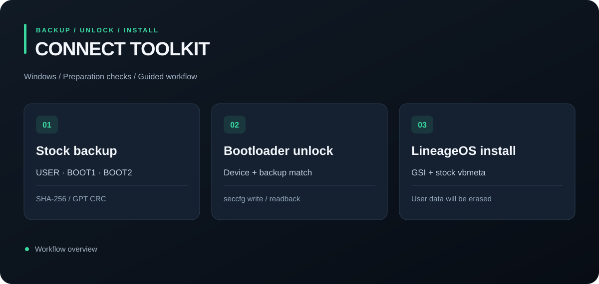

# Naver Connect Toolkit

[한국어](README.ko.md) · [English](README.md) · [日本語](README.ja.md)



Npay Connectの純正バックアップ、ブートローダーのロック解除、LineageOS導入、ADB接続とAPKインストールを行うWindowsツールです。対象はMT6768/MT6769系のNpay Connectです。

## 主な機能

| 機能 | 動作 |
| --- | --- |
| 純正バックアップ | eMMC USER・BOOT1・BOOT2、RAM Preloader、GPTを保存 |
| バックアップ検証 | ファイルサイズ、SHA-256、GPT CRCを確認 |
| ロック解除 | 実機のCID・GPT・seccfgをバックアップと照合し、書き込み後に再読出しで検証 |
| Fastbootへの切り替え | Preloaderとの通信後、実際のFastboot応答を確認 |
| LineageOS導入 | 指定GSIと純正vbmetaを検証してインストール |
| アプリ設定 | 無線ADB検索・ペアリング、APK検証・導入、コンソール起動 |
| 準備確認 | ドライバー、ツール、ファイル、空き容量の不足と対処方法を表示 |
| 画面プレビュー | 正常進行、ドライバー不足、切断、バックアップ検証エラーを再現 |

韓国語・英語・日本語を切り替えられます。入力値は切り替え後も保持します。

## 準備

Python 3.10以上（Tkinter付き）とAndroid Platform-Toolsを用意し、`adb`と`fastboot`をPATHに追加します。

```powershell
powershell -ExecutionPolicy Bypass -File scripts/setup.ps1
# バックアップ・ロック解除用のmtkclientも準備する場合:
powershell -ExecutionPolicy Bypass -File scripts/setup.ps1 -WithDeviceTools
```

- **Preview.cmd**：サンプルデータで画面とエラー処理を試します。
- **Connect.cmd**：実機操作画面を開きます。
- **Connect.cmd --cli**：USB、Fastboot、バックアップ検証メニューを開きます。

次の各モード用にWinUSBを別途インストールします。

| モード | USB ID |
| --- | --- |
| Preloader | `0E8D:2000` |
| BROM | `0E8D:0003` |
| Fastboot | `0E8D:201C` |
| fastbootd | `18D1:4EE0` |

FastbootにはAndroidのデバイスインターフェースGUIDが必要です。起動時は`.venv`を優先します。既存のmtkclientは`CONNECT_MTK_REPO`で指定できます。基準コミットは`118a000a83ea31c4f427fe5225abfe964546e05e`で、変更内容は`patches/`にあります。

## バックアップ → ロック解除 → OS導入

1. 35GB以上の空き容量がある新規保存先と対象シリアルを指定します。NASも利用できます。
2. 準備確認を実行し、表示された必要項目をそろえます。
3. バックアップから順に実行し、保存と検証を進めます。
4. 接続ツールの待機表示に合わせてUSBと電源をつなぎ直します。
5. 識別情報と純正seccfgを照合し、V4の512バイトの解除レコードを書き込んで8MiBの全領域を再検証します。
6. 案内に従って電源を再接続し、Fastbootの応答を確認します。
7. OS導入を選択した場合、シリアル・スロット・fastbootd・スナップショット状態を確認し、`system_a`、`userdata`、`vbmeta_a`の順に処理します。

**OS導入ではユーザーデータを消去します。** 同じ実機のPreloader・vbmeta・バックアップを使ってください。ケーブルと電源の操作、UAC承認、Android初期設定、デバッグ許可は案内に従って操作します。

対応イメージは[MisterZtrのLineageOS GSI](https://github.com/MisterZtr/LineageOS_gsi/releases/tag/v2026.01.05-lineage22.2)の`LineageOS-22.2-20260105-VANILLA-EXT4-GSI.img`（2,623,557,632バイト）です。登録済みSHA-256と一致するファイルを使用します。

## ADB接続とアプリ導入

ADB検索で接続先・ペアリング先・シリアルを確認し、無線デバッグの6桁コードを入力して接続します。複数端末がある場合は対象を選択します。

コンソール・診断APKとSHA-256マニフェストを指定すると、機種・起動状態の確認、Androidのミュート・通知制限・効果音設定、APK検証・導入、コンソール起動を順に行います。カードリーダーのブザーは独立したハードウェアです。Androidの音を戻す際は端末音量と通知制限を調整してください。

診断アプリは[naver-connect-diagnostics](https://github.com/pigeon-brain/naver-connect-diagnostics)にあります。コンソールAPKは別途用意します。

## 検証状況

| 項目 | 状態 |
| --- | --- |
| 個別のバックアップ・ロック解除・LineageOS導入手順 | 実機での成功記録あり |
| Androidミュート・アプリ導入 | 実機確認済み |
| 統合ツール | 書き込み範囲、ハッシュ、失敗時停止、画面、翻訳のオフライン確認済み |
| 追加検証 | 統合手順の実機通し試験、新規PC準備、実際の純正復元 |
| 未実装機能 | 自動復元、再ロック、中断処理の自動再開、単独の工場初期化 |
| バックアップ対象外 | RPMB、別体セキュアエレメント、決済キー、サーバー側登録・認証状態 |

ファイル検証と復元試験は別の確認です。動作中の端末でOS導入を繰り返すとデータが消去されます。詳細は`verification.json`を参照してください。

## ログと問題解決

検査失敗時は処理を停止し、準備画面に対処方法を表示します。ログと実機の状態を確認して次の操作を選んでください。

- 処理ログ：`logs/`
- 準備確認：`logs/preflight-latest.json`
- ステップの状態：`logs/workflow-state.json`
- Android設定ログ：ユーザーホームの`ConnectSetup/logs`

ログ共有前に端末識別子と個人パスを削除してください。バックアップ、鍵、ペアリングコードは個人で保管します。

```powershell
python -m unittest discover -p "test_*.py"
python scripts/check_public_tree.py
```

## 配布

ソースと起動スクリプトを[GPL-3.0](LICENSE)で配布します。APK、ファームウェア、フォント、USBドライバー、検証マニフェストは利用権限のあるものを別途用意してください。

個人開発のプロジェクトです。[CONTRIBUTING.md](CONTRIBUTING.md)、[SECURITY.md](SECURITY.md)、[THIRD_PARTY.md](THIRD_PARTY.md)も参照してください。
