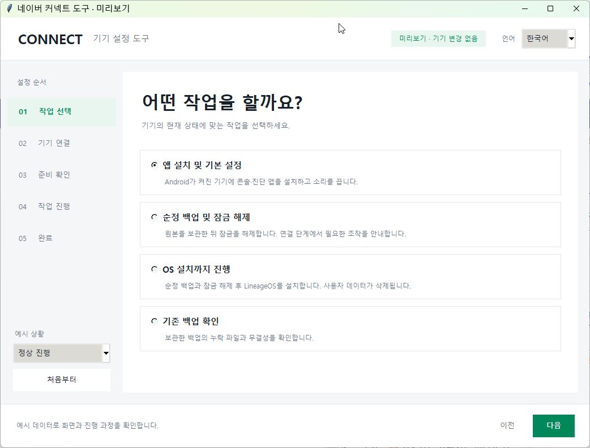

# 네이버 커넥트 도구

[한국어](README.ko.md) · [English](README.md) · [日本語](README.ja.md)



네이버페이 커넥트의 순정 백업, 부트로더 잠금 해제, LineageOS 설치, ADB 연결과 APK 설치를 진행하는 Windows 도구입니다. 대상 기기는 MT6768/MT6769 계열 Npay Connect입니다.

## 주요 기능

| 기능 | 동작 |
| --- | --- |
| 순정 백업 | eMMC USER·BOOT1·BOOT2, RAM Preloader, GPT 저장 |
| 백업 검증 | 파일 크기, SHA-256, GPT CRC 검사 |
| 부트로더 잠금 해제 | 기기와 백업의 CID·GPT·seccfg 대조 후 쓰기 및 재읽기 검증 |
| Fastboot 전환 | Preloader 통신 후 실제 Fastboot 응답 확인 |
| LineageOS 설치 | 지정 GSI와 순정 vbmeta 검증 후 설치 |
| 앱 설치 | 무선 ADB 검색·페어링, APK 해시 검사·설치, 콘솔 실행 |
| 준비 상태 검사 | 드라이버, 도구, 파일, 저장 공간의 부족 항목과 해결 방법 표시 |
| 화면 미리보기 | 정상 진행, 드라이버 누락, 연결 끊김, 백업 검사 실패 시뮬레이션 |

화면 언어는 한국어·영어·일본어를 지원합니다. 언어를 바꿔도 입력값은 유지됩니다.

## 시작하기

Python 3.10 이상(Tkinter 포함)과 Android Platform-Tools를 설치하고 `adb`, `fastboot`를 PATH에 추가합니다.

```powershell
powershell -ExecutionPolicy Bypass -File scripts/setup.ps1
# 백업·언락용 mtkclient 환경도 준비하려면:
powershell -ExecutionPolicy Bypass -File scripts/setup.ps1 -WithDeviceTools
```

- **Preview.cmd**: 샘플 데이터로 설치 화면과 오류 처리를 체험합니다.
- **Connect.cmd**: 실기기 작업 화면을 엽니다.
- **Connect.cmd --cli**: USB 조회, Fastboot, 백업 검증 메뉴를 엽니다.

실기기 작업에는 아래 모드별 WinUSB 드라이버를 별도로 설치합니다.

| 모드 | USB ID |
| --- | --- |
| Preloader | `0E8D:2000` |
| BROM | `0E8D:0003` |
| Fastboot | `0E8D:201C` |
| fastbootd | `18D1:4EE0` |

Fastboot 계열에는 Android 장치 인터페이스 GUID가 필요합니다. 실행기는 `.venv`를 우선 사용하며, 외부 mtkclient 경로는 `CONNECT_MTK_REPO`로 지정합니다. 기준 커밋은 `118a000a83ea31c4f427fe5225abfe964546e05e`이고 관련 패치는 `patches/`에 있습니다.

## 백업 → 잠금 해제 → OS 설치

1. 35GB 이상의 여유 공간이 있는 새 백업 폴더와 대상 시리얼을 지정합니다. NAS 경로도 사용할 수 있습니다.
2. **설정 검사**에서 준비 상태와 필요한 조치를 확인합니다.
3. **백업부터 순서대로 실행**을 누르면 백업 저장과 검증을 진행합니다.
4. **연결 도구 대기 중** 안내에 맞춰 USB와 전원을 다시 연결합니다.
5. 기기 식별 정보와 원본 seccfg를 대조한 뒤 V4 잠금 해제 레코드 512바이트를 기록하고 전체 8MiB를 다시 읽어 검증합니다.
6. 안내에 따라 전원을 다시 연결하고 Fastboot 응답을 확인합니다.
7. **OS 설치 포함**을 선택한 경우 시리얼·슬롯·fastbootd·스냅샷 상태를 확인하고 `system_a`, `userdata`, `vbmeta_a` 순서로 처리합니다.

**OS 설치는 사용자 데이터를 삭제합니다.** 해당 기기에서 추출한 Preloader·vbmeta·백업을 사용하세요. 전원·케이블 조작, UAC 승인, Android 초기 설정과 디버깅 허용은 화면 안내에 따라 직접 진행합니다.

지원 이미지는 [MisterZtr의 LineageOS GSI](https://github.com/MisterZtr/LineageOS_gsi/releases/tag/v2026.01.05-lineage22.2)의 `LineageOS-22.2-20260105-VANILLA-EXT4-GSI.img`(2,623,557,632바이트)입니다. 등록된 SHA-256과 일치하는 이미지를 사용합니다.

## ADB 연결과 앱 설치

**ADB 기기 검색**으로 연결 주소·페어링 주소·시리얼을 찾고, 무선 디버깅의 6자리 코드를 입력해 **무선 페어링 및 연결**을 누릅니다. 여러 기기가 연결된 경우 대상을 선택합니다.

콘솔·진단 APK와 SHA-256 매니페스트를 지정한 뒤 **음소거 및 앱 설치**를 실행합니다. 모델·부팅 상태 확인, Android 미디어 음소거·방해금지·효과음 설정, APK 검증·설치, 콘솔 실행을 순서대로 진행합니다. 카드 리더 부저는 별도 하드웨어입니다. 소리를 다시 사용하려면 기기 음량과 방해금지 설정을 조절하세요.

진단 앱 소스는 [naver-connect-diagnostics](https://github.com/pigeon-brain/naver-connect-diagnostics)에 있습니다. 콘솔 APK는 별도로 준비합니다.

## 검증 상태

| 항목 | 확인 범위 |
| --- | --- |
| 개별 백업·언락·LineageOS 설치 절차 | 실기 성공 기록 |
| Android 음소거·앱 설치 흐름 | 실기 확인 |
| 통합 도구 | 쓰기 범위·해시·실패 시 중단·화면·번역의 오프라인 검사 완료 |
| 추가 검증 | 통합 백업→설치 전체 실기 재시험, 새 PC 준비 과정, 실제 순정 복원 |
| 미구현 기능 | 자동 복원, 재잠금, 중단 작업 자동 재개, 별도 공장 초기화 |
| 백업 제외 영역 | RPMB, 별도 보안칩, 결제 키, 서버 측 등록·인증 상태 |

파일 검증과 실제 복원 시험은 별도 단계입니다. 검증 목적으로 정상 설치된 기기에 OS 설치를 반복하면 데이터가 삭제됩니다. 상세 기록은 `verification.json`을 참조하세요.

## 로그와 문제 해결

검사 실패 시 해당 단계에서 멈추며 **준비 상태**에 해결 방법을 표시합니다. 로그와 기기 상태를 확인한 뒤 필요한 단계를 선택하세요.

- 작업 로그: `logs/`
- 준비 검사: `logs/preflight-latest.json`
- 단계별 상태: `logs/workflow-state.json`
- Android 설정 로그: 사용자 홈의 `ConnectSetup/logs`

로그를 공유할 때는 기기 식별자와 개인 경로를 제거하세요. 백업·키·페어링 코드는 개인 저장소에 보관합니다.

```powershell
python -m unittest discover -p "test_*.py"
python scripts/check_public_tree.py
```

## 배포

소스와 실행 스크립트를 [GPL-3.0](LICENSE)으로 배포합니다. APK, 펌웨어, 글꼴, USB 드라이버와 검증 매니페스트는 사용 권한이 있는 파일을 별도로 준비하세요.

개인 개발 프로젝트입니다. 기여 방법은 [CONTRIBUTING.md](CONTRIBUTING.md), 보안 안내는 [SECURITY.md](SECURITY.md), 외부 코드 출처는 [THIRD_PARTY.md](THIRD_PARTY.md)에 있습니다.
