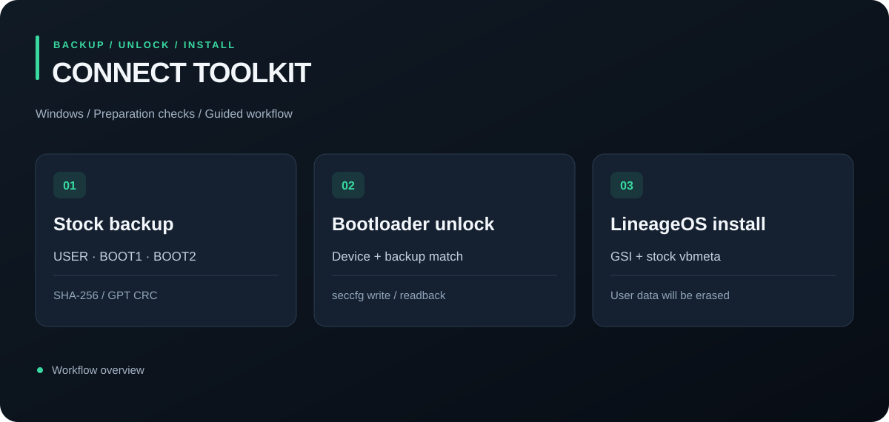

# Naver Connect Toolkit

[한국어](README.ko.md) · [English](README.md) · [日本語](README.ja.md)



A Windows tool for backing up Npay Connect, unlocking its bootloader, installing LineageOS, and connecting through ADB to install apps. Targets the MT6768/MT6769 Npay Connect.

## Features

| Feature | Operation |
| --- | --- |
| Stock backup | Save eMMC USER, BOOT1, BOOT2, RAM Preloader and GPT |
| Backup verification | Check file sizes, SHA-256 and GPT CRC |
| Bootloader unlock | Match device CID, GPT and seccfg with the backup; write and verify by readback |
| Fastboot transition | Send the Preloader handshake and confirm actual Fastboot responses |
| LineageOS installation | Verify the selected GSI and stock vbmeta, then install |
| App setup | Discover and pair wireless ADB, verify APK hashes, install apps and launch the console |
| Preparation checks | Show missing drivers, tools, files and free space with suggested fixes |
| Interface preview | Simulate progress, missing drivers, connection loss and backup verification errors |

The interface supports Korean, English and Japanese. Switching languages preserves entered values.

## Getting started

Install Python 3.10+ with Tkinter and Android Platform-Tools. Add `adb` and `fastboot` to PATH.

```powershell
powershell -ExecutionPolicy Bypass -File scripts/setup.ps1
# Also prepare mtkclient for backup and unlock:
powershell -ExecutionPolicy Bypass -File scripts/setup.ps1 -WithDeviceTools
```

- **Preview.cmd** opens the simulated setup interface.
- **Connect.cmd** opens the device-operation interface.
- **Connect.cmd --cli** opens USB, Fastboot and backup-verification menus.

Install WinUSB drivers separately for these modes:

| Mode | USB ID |
| --- | --- |
| Preloader | `0E8D:2000` |
| BROM | `0E8D:0003` |
| Fastboot | `0E8D:201C` |
| fastbootd | `18D1:4EE0` |

Fastboot requires the Android device-interface GUID. Launchers prefer `.venv`. Set `CONNECT_MTK_REPO` to use an existing checkout. The pinned mtkclient commit is `118a000a83ea31c4f427fe5225abfe964546e05e`; local fixes are documented in `patches/`.

## Backup → unlock → install

1. Choose the target serial and a new backup folder with at least 35GB free. NAS paths are supported.
2. Run the preparation check and resolve the listed requirements.
3. Start the backup-first workflow to save and verify the backup.
4. Reconnect USB and power when the connection tool reports that it is waiting.
5. The tool matches device identity and stock seccfg, writes the supported V4 512-byte unlock record, then verifies the full 8MiB partition.
6. Follow the power-reconnection prompt and confirm Fastboot detection.
7. With OS installation selected, the tool checks serial, slot, fastbootd and snapshot state, then processes `system_a`, `userdata` and `vbmeta_a` in order.

**OS installation erases user data.** Use Preloader, vbmeta and backups from the same device. Follow the prompts for cables, power, UAC approval, Android setup and debugging authorization.

The supported image is `LineageOS-22.2-20260105-VANILLA-EXT4-GSI.img` (2,623,557,632 bytes) from [MisterZtr's LineageOS GSI](https://github.com/MisterZtr/LineageOS_gsi/releases/tag/v2026.01.05-lineage22.2). Its SHA-256 must match the tool's allowlist.

## ADB and app installation

Use ADB discovery to find connection and pairing addresses, enter the six-digit wireless-debugging code, and pair. Select the intended device when several are connected.

Select the console and diagnostics APKs with their SHA-256 manifest. The mute-and-install action verifies the device and Android boot state, configures Android media muting, Do Not Disturb and sound effects, verifies and installs the APKs, then launches the console. The card reader has a separate hardware buzzer. Adjust device volume and Do Not Disturb to restore Android sound.

Diagnostic app sources are in [naver-connect-diagnostics](https://github.com/pigeon-brain/naver-connect-diagnostics). Prepare the console APK separately.

## Verification status

| Area | Status |
| --- | --- |
| Individual backup, unlock and LineageOS installation procedures | Successful hardware-session records |
| Android mute and app-install workflow | Hardware verified |
| Integrated tool | Offline checks of write boundaries, hashes, failure stops, interface and translations completed |
| Further validation | Full integrated backup-to-install hardware run, clean-PC setup and actual stock restoration |
| Unimplemented features | Automatic restoration, relocking, interrupted-operation resume and standalone factory reset |
| Backup exclusions | RPMB, separate secure elements, payment keys and server-side registration/authentication |

File verification and a restoration test are separate checks. Repeating OS installation on a working device erases its data. See `verification.json` for detailed evidence.

## Logs and troubleshooting

A failed check stops the workflow and displays suggested fixes in the preparation view. Review the log and device state before choosing the next step.

- Workflow logs: `logs/`
- Preparation results: `logs/preflight-latest.json`
- Step status: `logs/workflow-state.json`
- Android setup logs: `ConnectSetup/logs` under the user's home directory

Remove device identifiers and private paths before sharing logs. Keep backups, keys and pairing codes private.

```powershell
python -m unittest discover -p "test_*.py"
python scripts/check_public_tree.py
```

## Distribution

Source and launch scripts use [GPL-3.0](LICENSE). Supply authorized APKs, firmware, fonts, USB drivers and verification manifests separately.

An independently developed project. See [CONTRIBUTING.md](CONTRIBUTING.md), [SECURITY.md](SECURITY.md) and [THIRD_PARTY.md](THIRD_PARTY.md).
